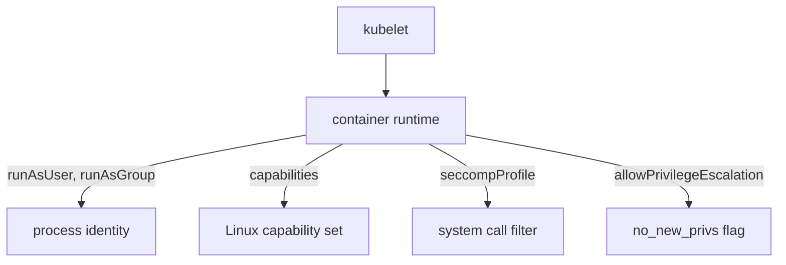

# Security Contexts And Profile Requirements

Every container in a pod starts as a process on a node. The settings that decide which user runs it, which privileges it keeps and which system calls it may use live in a field called `securityContext`. A security context is a group of settings that the kubelet (the agent on each node) passes to the container runtime when it creates the container. This part shows where those fields sit and what each one changes inside the node.

## Two levels, one effective value

A `securityContext` can appear at pod level (`spec.securityContext`) and at container level (`spec.containers[*].securityContext`). Pod-level values are defaults for every container in the pod, including init containers. A container-level value for the same field wins. Some fields exist in only one place: `fsGroup` is pod-level only, and `capabilities`, `privileged`, `allowPrivilegeEscalation` and `readOnlyRootFilesystem` are container-level only.

Look at the effective settings of the running `scout` pod. First check what the pod declares:

<!-- astrona:playground:renew -->

```sh
kubectl -n starfleet get deploy scout -o jsonpath='{.spec.template.spec.securityContext}{"\n"}{.spec.template.spec.containers[0].securityContext}{"\n"}'
```

Both lines are empty. The pod declares nothing, so the container runtime applies its own defaults: the user that the image sets, the default Linux capability set, and no seccomp filter unless the runtime or kubelet adds one. A missing `securityContext` is the weakest configuration, not a neutral one.

## What each field does underneath

`runAsUser` and `runAsGroup` set the numeric user ID (UID) and group ID (GID) of the container process. The runtime applies them when it starts the process. If you omit `runAsUser`, the user comes from the image's `USER` instruction, and many images run as UID 0 (root).

`runAsNonRoot: true` does not choose a user. It is a check. Before it starts the container, the kubelet reads the effective UID. If the UID is 0, the kubelet refuses to start the container. If the image names its user as text (for example `USER app`) and the pod sets no `runAsUser`, the kubelet cannot prove the user is not root and also refuses to start it. The fix is a numeric `runAsUser`.

`allowPrivilegeEscalation: false` sets the Linux `no_new_privs` flag on the process. With that flag, a child process cannot gain more privileges than its parent, for example through a set-user-ID binary. When a container is `privileged` or has the `CAP_SYS_ADMIN` capability, this field is always true, so the combination is invalid for hardening.

`capabilities` splits the power of root into units. A container starts with a default set (for example `CHOWN`, `NET_BIND_SERVICE`, `SETUID`). `drop: ["ALL"]` removes all of them. `add` gives back only the ones the application needs. A process with no capabilities cannot change file ownership, load modules or change the system clock, even when it runs as UID 0.

`seccompProfile` selects a filter of allowed system calls. `type: RuntimeDefault` uses the filter shipped with the container runtime, which blocks dozens of rarely needed and dangerous calls. `type: Unconfined` turns the filter off. `type: Localhost` loads a profile file from the node.

`readOnlyRootFilesystem: true` mounts the container's root filesystem read-only. It does not appear in the Pod Security Standards, but it stops a compromised process from writing tools into the image filesystem. The application then needs a writable volume for its temporary files.

`privileged: true` gives the container nearly all capabilities and access to host devices. It is the opposite of every setting above.



The diagram shows that the kubelet hands the fields to the container runtime, and the runtime applies each one to the Linux process when it creates the container.

## A first hardened pod

Save this as `pod-hardened.yaml`:

```yaml
apiVersion: v1
kind: Pod
metadata:
  name: hardened
  namespace: starfleet
spec:
  containers:
    - name: probe
      image: mccutchen/go-httpbin:2.25.0
      securityContext:
        runAsNonRoot: true
        runAsUser: 10001
        allowPrivilegeEscalation: false
        capabilities:
          drop: ["ALL"]
        seccompProfile:
          type: RuntimeDefault
```

Apply it:

```sh
kubectl apply -f pod-hardened.yaml
```

Then check the result:

```sh
kubectl -n starfleet get pod hardened -o jsonpath='{.spec.containers[0].securityContext.runAsUser}{"\n"}'
```

The command prints `10001`. The pod keeps running because the application listens on port 8080, which a non-root process may bind without any capability. A port below 1024 would need `NET_BIND_SERVICE`.

## Writable paths and file ownership

A non-root process can read only what its UID is allowed to read. If the image keeps data in a directory owned by root, the process fails with a permission error after you set `runAsUser`. The usual fix is a volume for the writable path. `fsGroup` sets the group that owns the contents of supported volumes, so a non-root process can write to them.

Do not remove the security settings when an application fails to start. Find the path it writes to, mount an `emptyDir` volume there, and keep the restriction.

## Settings that look the same but are not

`runAsNonRoot` is a check and `runAsUser` is a value. `drop: ["ALL"]` removes capabilities but does not stop a container from running as root, and root without capabilities still owns its files. `allowPrivilegeEscalation: false` does not remove capabilities already granted. Each field closes one path, so one setting never implies the others.

Delete the test pod when you finish:

```sh
kubectl -n starfleet delete pod hardened
```

You now know which field controls which part of the process. The open question is which combination of these settings a cluster should demand, and that is what the profiles define.

## Common pitfalls

> [!WARNING]
> `runAsNonRoot: true` alone fails when the image uses a text user name; add a numeric `runAsUser`. A pod-level field is overridden by the same field on a container. Removing a setting to make an application start throws away the protection it gave.
