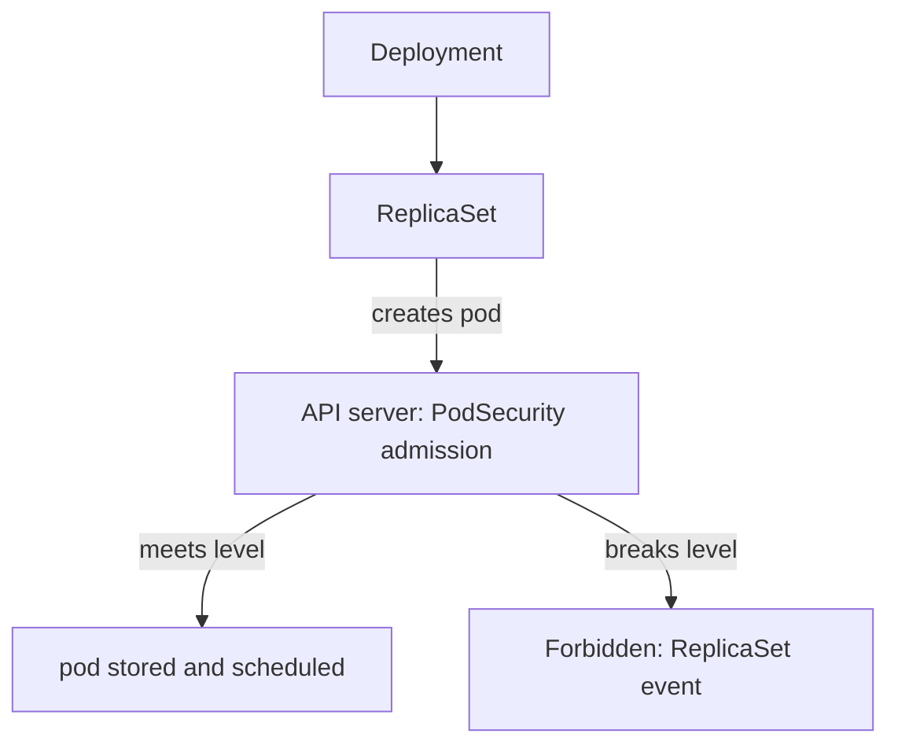

# Profiles And Compliant Workloads

A list of single fields does not tell a cluster owner what to require. The Pod Security Standards group the fields into three profiles, so a namespace can ask for "Baseline" or "Restricted" instead of a hundred separate checks. This part lists what each profile controls and then fixes a workload that breaks the strictest one.

## The three profiles

The **Privileged** profile has no restrictions. It exists for system components that need host access, such as a CNI (container network interface) plugin or a storage driver.

The **Baseline** profile blocks the known ways a container can take over the node while still allowing most ordinary workloads. It requires, for every container, init container and ephemeral container:

- `hostNetwork`, `hostPID` and `hostIPC` are unset or `false`.
- `privileged` is unset or `false`.
- `capabilities.add` contains only: `AUDIT_WRITE`, `CHOWN`, `DAC_OVERRIDE`, `FOWNER`, `FSETID`, `KILL`, `MKNOD`, `NET_BIND_SERVICE`, `SETFCAP`, `SETGID`, `SETPCAP`, `SETUID`, `SYS_CHROOT`.
- No `hostPath` volumes, and no `hostPort` values other than 0 or unset.
- The seccomp profile is not `Unconfined`, the AppArmor profile is `RuntimeDefault` or `Localhost` when set, and `procMount` is `Default`.
- SELinux options are limited to a short list of safe types, and user and role are unset.

The **Restricted** profile follows current hardening practice. It includes everything in Baseline and adds:

- Volume types are limited to `configMap`, `csi`, `downwardAPI`, `emptyDir`, `ephemeral`, `persistentVolumeClaim`, `projected` and `secret`.
- `allowPrivilegeEscalation` must be `false`.
- Containers must run as non-root: `runAsNonRoot: true`, and `runAsUser` must not be 0.
- `seccompProfile.type` must be `RuntimeDefault` or `Localhost`.
- `capabilities.drop` must include `ALL`, and `capabilities.add` may contain only `NET_BIND_SERVICE`.

Notice what is not in Restricted: `readOnlyRootFilesystem` is good practice but no profile requires it.

## How a profile reaches a pod

The profile is not a runtime feature. It is a rule that the Pod Security Admission controller (a plugin built into the API server) applies to a pod specification when the pod is created or updated. A namespace label chooses the level. For example, `pod-security.kubernetes.io/enforce: restricted` makes the plugin reject any new pod in that namespace that breaks a Restricted control. The plugin reads the pod specification only. It does not look inside the running container.

Create a namespace that enforces the level and try to start a pod that breaks it. Save this as `namespace-hangar.yaml`:

```yaml
apiVersion: v1
kind: Namespace
metadata:
  name: hangar
  labels:
    pod-security.kubernetes.io/enforce: restricted
```

Apply it:

<!-- astrona:playground:renew -->

```sh
kubectl apply -f namespace-hangar.yaml
```

Now save a pod that has no security context as `pod-plain.yaml`:

```yaml
apiVersion: v1
kind: Pod
metadata:
  name: plain
  namespace: hangar
spec:
  containers:
    - name: probe
      image: mccutchen/go-httpbin:2.25.0
```

Apply it:

```sh
kubectl apply -f pod-plain.yaml
```

The API server refuses the request with an error that starts with `Error from server (Forbidden)` and names the pod security level. The message lists each violated control, for example the missing `allowPrivilegeEscalation`, `capabilities`, `runAsNonRoot` and `seccompProfile` settings. Read that list: it tells you exactly which fields to add.

## Fixing the workload

Save the fixed pod as `pod-compliant.yaml`:

```yaml
apiVersion: v1
kind: Pod
metadata:
  name: compliant
  namespace: hangar
spec:
  containers:
    - name: probe
      image: mccutchen/go-httpbin:2.25.0
      securityContext:
        runAsNonRoot: true
        runAsUser: 10001
        allowPrivilegeEscalation: false
        capabilities:
          drop: ["ALL"]
        seccompProfile:
          type: RuntimeDefault
```

Apply it and check that it runs:

```sh
kubectl apply -f pod-compliant.yaml
kubectl -n hangar get pod compliant
```

The pod is admitted because every Restricted control is satisfied. The same settings on a Deployment go under `spec.template.spec`. When you enforce a level on a namespace that already has Deployments, the existing pods keep running. The Deployment is accepted too. The rejection happens later, when the ReplicaSet controller tries to create a replacement pod, so the failure appears in the events of the ReplicaSet, not in the Deployment.



The diagram shows that the profile check happens on the pod object, one step after the Deployment was accepted.

## What compliance does not prove

A pod that meets Restricted can still run vulnerable code, hold an over-broad ServiceAccount token, store secrets in plain environment variables or accept traffic from every namespace. The profile limits what the process can do to the node. It says nothing about the application, the image contents or API permissions. A request refused by the profile is also not an authentication or RBAC (role-based access control) failure: the user may be fully authorized to create pods and the pod is still refused.

Clean up:

```sh
kubectl delete namespace hangar
```

You now know the controls and how a failing pod is diagnosed. The remaining question for a platform team is how to introduce a level on a namespace that already runs workloads without breaking them, which depends on admission modes.

## Common pitfalls

> [!WARNING]
> A Deployment that breaks the level is accepted; its pods are rejected later, so check the ReplicaSet events. Restricted does not require `readOnlyRootFilesystem`. Adding `NET_BIND_SERVICE` is the only capability Restricted allows, and only after `drop: ["ALL"]`. Meeting a profile does not make the application safe.
