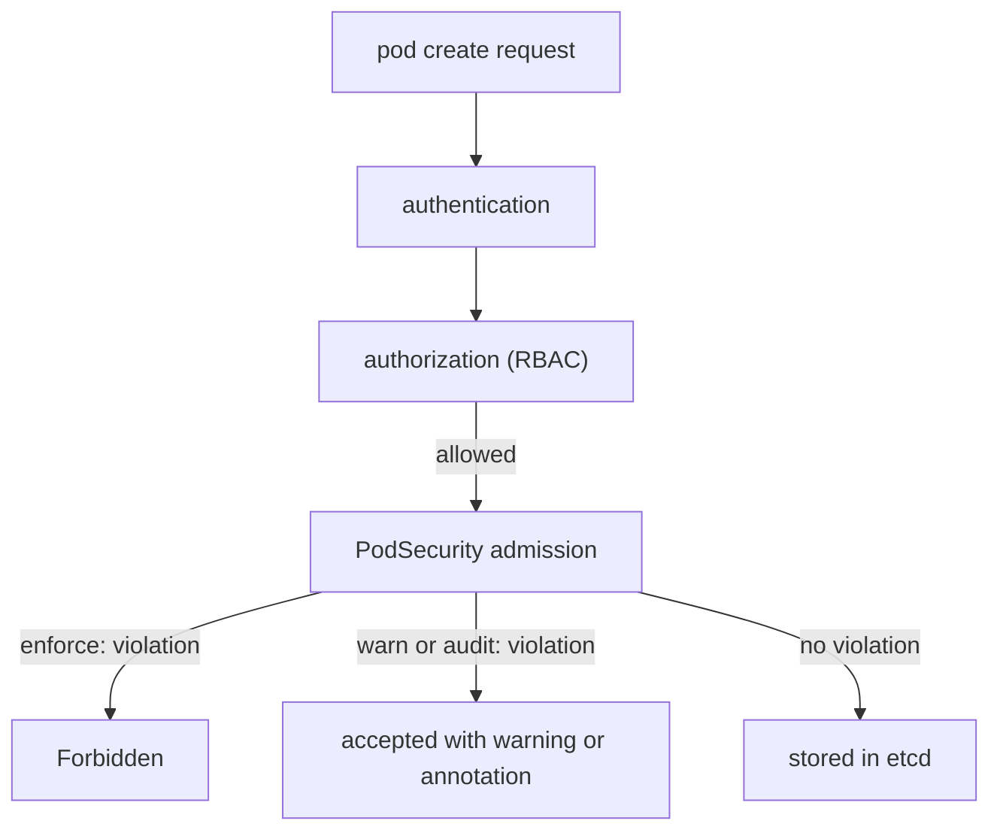

# Applying Pod Security Requirements At Admission

A cluster owner needs a rule that every new pod in a namespace meets a security level, without writing a policy language. Pod Security Admission solves this with three labels on the namespace. This part shows how the labels work, what the API server does with them and why the same violation can produce a rejection, a warning or only a log annotation.

## Where the decision happens

Every request that creates or updates an object goes through the API server in a fixed order: authentication, authorization, then admission. Admission controllers are plugins that can accept, change or refuse the object. The `PodSecurity` admission plugin is one of them and is enabled by default. It compares the pod specification with the level chosen for the namespace.



The diagram shows that PodSecurity admission runs after RBAC. A request that RBAC denied never reaches it.

## The label format

The labels on a namespace have the form `pod-security.kubernetes.io/<mode>: <level>`. The mode is `enforce`, `audit` or `warn`. The level is `privileged`, `baseline` or `restricted`. An optional second label, `pod-security.kubernetes.io/<mode>-version: <version>`, pins the rules to a Kubernetes minor version such as `v1.35`, or to `latest`.

The three modes act differently when a pod breaks the level:

- `enforce`: the API server refuses the pod.
- `warn`: the API server accepts the pod and sends a warning to the user who made the request. `kubectl` prints it.
- `audit`: the API server accepts the pod and adds an annotation to the audit event. Nothing is shown to the user.

A namespace can set any of the modes, each with its own level. A common migration setting is `enforce: baseline` with `warn: restricted` and `audit: restricted`.

Save this as `namespace-dock.yaml`:

```yaml
apiVersion: v1
kind: Namespace
metadata:
  name: dock
  labels:
    pod-security.kubernetes.io/enforce: baseline
    pod-security.kubernetes.io/enforce-version: v1.35
    pod-security.kubernetes.io/warn: restricted
    pod-security.kubernetes.io/audit: restricted
```

Apply it:

<!-- astrona:playground:renew -->

```sh
kubectl apply -f namespace-dock.yaml
```

Then check the labels:

```sh
kubectl get namespace dock --show-labels
```

## Version selection

The rules of a level change between Kubernetes releases. When a label says `latest` or has no version label, the plugin uses the rules of the running API server version. When the label pins `v1.35`, the plugin uses the rules as they were in 1.35, even after a cluster upgrade. Pin the version when you want an upgrade not to change which pods are accepted. Leave it at `latest` when you want new hardening rules to apply automatically.

## One violation, three results

Save a pod that is privileged as `pod-privileged.yaml`:

```yaml
apiVersion: v1
kind: Pod
metadata:
  name: privileged-test
  namespace: dock
spec:
  containers:
    - name: probe
      image: mccutchen/go-httpbin:2.25.0
      securityContext:
        privileged: true
```

Apply it:

```sh
kubectl apply -f pod-privileged.yaml
```

The pod breaks Baseline, so the `enforce` mode refuses it with a `Forbidden` error that names the level and the violated control. Now save a pod that meets Baseline but not Restricted as `pod-plain.yaml`:

```yaml
apiVersion: v1
kind: Pod
metadata:
  name: plain-test
  namespace: dock
spec:
  containers:
    - name: probe
      image: mccutchen/go-httpbin:2.25.0
```

Apply it:

```sh
kubectl apply -f pod-plain.yaml
```

This pod is created. The `enforce` level is Baseline and the pod meets it. The `warn` level is Restricted, so `kubectl` prints a warning that lists the Restricted controls the pod misses. The `audit` level adds an annotation to the audit event, which you cannot see in the terminal.

## Workload resources and pods

A Deployment, StatefulSet, Job or CronJob contains a pod template. The `warn` and `audit` modes check that template, so the person who applies the Deployment sees the warning right away. The `enforce` mode does not check the Deployment. It checks only the Pod objects. A Deployment with a violating template is accepted, and the ReplicaSet controller then fails to create its pods. The failure shows in the ReplicaSet events and in the Deployment's `Available` condition.

This also means that pods already running are never stopped by a label change. A level change affects only pods created or updated afterwards, for example when a node drains and a replacement pod starts.

Clean up:

```sh
kubectl delete namespace dock
```

You can now predict what each label does. The next problem is operational: how to change a live namespace without a surprise rejection.

## Common pitfalls

> [!WARNING]
> A misspelled label key such as `pod-security.kubernetes.io/enforc` is accepted by the API server and does nothing. An `enforce` label does not remove running pods. A Deployment is not rejected, only its pods are. The `audit` mode shows nothing in the terminal.
