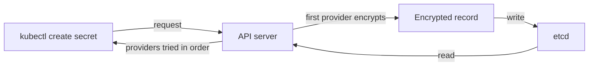

# Secret Storage And Encryption At Rest

A Secret protects a value only as far as the cluster stores and serves it carefully. This part shows what the API server writes to etcd, what encryption at rest changes and who can still read the value after you enable it.

## What a Secret contains

A Secret has a type and a map of keys to values. The type tells tools what keys to expect. `Opaque` is the default and has no rules. `kubernetes.io/tls` requires `tls.crt` and `tls.key`. `kubernetes.io/dockerconfigjson` holds registry credentials. `kubernetes.io/basic-auth` requires a `username` or `password` key. `kubernetes.io/service-account-token` holds a legacy ServiceAccount token. A Secret is limited to one mebibyte.

The `data` field holds base64-encoded values. The `stringData` field accepts plain text and the API server encodes it on write. Base64 turns bytes into printable characters. It uses no key, and anyone can decode it with `base64 -d`. Seeing a Secret as base64 text in `kubectl get secret -o yaml` is a display format, not a protection.

## Look at the stored record

By default the API server writes the Secret to etcd exactly as it received it. Renew the playground, create a Secret and read it from etcd to see what is stored:

<!-- astrona:playground:renew -->

```sh
kubectl -n starfleet create secret generic db-password --from-literal=password=warp-core-7
kubectl -n starfleet get secret db-password -o jsonpath='{.data.password}' | base64 -d
```

The second command prints the value. Now read the record in etcd. The `kind` control plane runs etcd as a Pod. The command uses the etcd client certificates from the control plane node:

```sh
ETCD="$(kubectl -n kube-system get pod -l component=etcd -o name)"
kubectl -n kube-system exec "$ETCD" -- etcdctl --endpoints=https://127.0.0.1:2379 --cacert=/etc/kubernetes/pki/etcd/ca.crt --cert=/etc/kubernetes/pki/etcd/server.crt --key=/etc/kubernetes/pki/etcd/server.key get /registry/secrets/starfleet/db-password | grep -a warp-core-7
```

The value appears in plain text in the etcd record. Anyone who can read etcd, its data directory or a backup of it can read every Secret in the cluster. The API server's RBAC does not protect etcd.

## Encryption at rest

Encryption at rest makes the API server encrypt Secret data before it writes to etcd and decrypt on read. It is configured with an `EncryptionConfiguration` file that the API server reads through `--encryption-provider-config`. Save this as `encryption-config.yaml`:

```yaml
apiVersion: apiserver.config.k8s.io/v1
kind: EncryptionConfiguration
resources:
  - resources:
      - secrets
    providers:
      - aescbc:
          keys:
            - name: key1
              secret: BASE64_OF_A_32_BYTE_RANDOM_KEY
      - identity: {}
```

The providers are an ordered list. The first provider encrypts every write. On read, the API server tries each provider until one decrypts the record. `identity` stores data unencrypted. Keeping it last lets the API server still read old plaintext records. Putting it first turns encryption off.

The providers differ in where the key lives. `aescbc` and `aesgcm` use a key stored in the configuration file on the control plane node, so a person with access to that node reads the key. `secretbox` uses XSalsa20 and Poly1305 with a local key. A KMS provider sends a data encryption key to an external key management service and stores only the wrapped key, so the key encryption key never sits on the node.



## Existing Secrets stay plaintext

Turning on encryption changes only new writes. A Secret written earlier stays plain in etcd until it is written again. Rewrite every Secret with this command after the API server restarts with the new configuration:

```sh
kubectl get secrets -A -o json | kubectl replace -f -
```

Then repeat the etcd read. An encrypted record starts with the prefix `k8s:enc:aescbc:v1:key1` followed by bytes that do not contain the value. To rotate the key, add the new key first in the list, restart the API servers, rewrite all Secrets and then remove the old key.

## Who can still read the value

Encryption at rest protects the etcd files and backups. It does not protect the value from an authenticated caller with RBAC access, because the API server decrypts it for them. It does not protect the value on the node either. The kubelet mounts a Secret into a Pod as a file in a memory-backed volume, and a process with access to the container or the node can read it. The Node authorizer restricts each kubelet to the Secrets used by Pods on its node, so a compromised node exposes only those Secrets.

An immutable Secret is marked with `immutable: true`. The API server refuses changes to its data, and the kubelet stops watching it, which reduces load. To change the value, create a new Secret and update the Pod template.

## Check whether encryption is enabled

The API server shows its flags in its static Pod. If the flag `--encryption-provider-config` is absent, Secrets are stored in plain text. Check it with this command:

```sh
kubectl -n kube-system get pod -l component=kube-apiserver -o jsonpath='{.items[0].spec.containers[0].command}' | tr ',' '\n' | grep encryption
```

No output means that no encryption configuration is set. On a managed cluster the provider may encrypt etcd with its own keys. The setting is then outside your control, and the provider documentation is the only source of truth for it.

## Common pitfalls

> [!WARNING]
> - Treating base64 as encryption. It is a reversible encoding with no key.
> - Enabling encryption but never rewriting existing Secrets. Old records stay in plain text.
> - Putting `identity` first in the provider list. The API server then stops encrypting.
> - Keeping an `aescbc` key in the same backup as etcd. The backup holds both the data and its key.
> - Expecting encryption at rest to stop a user with `get` on Secrets. The API server decrypts for authorized callers.
