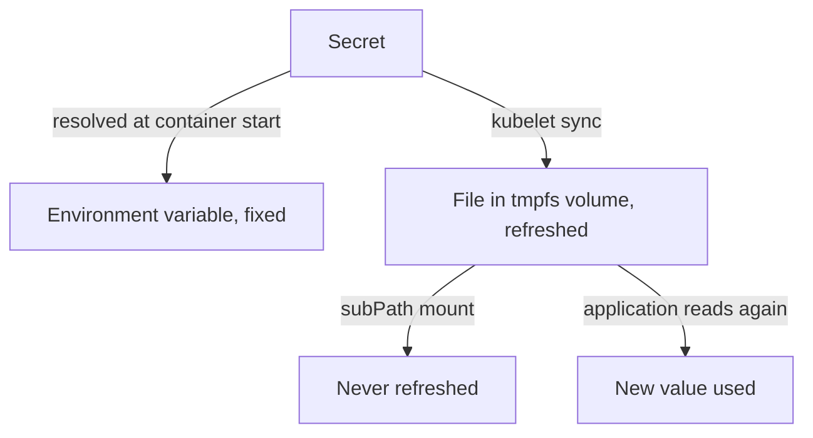

# Delivery, Rotation And Exposure Paths

A Secret reaches a process in one of two ways: as an environment variable or as a file. The choice decides how the value updates, who can read it on the node, and how a rotation works. This part walks through both delivery paths, then shows how to rotate a credential and where a value tends to escape.

## Environment variables

A container can take a Secret key as an environment variable with `secretKeyRef`, or take all keys with `envFrom`. The kubelet resolves the value when it creates the container and sets it in the process environment. The value is then fixed for the life of that container. Updating the Secret does not change it. Only a new container receives the new value.

Environment variables are inherited by every child process. They are listed in `/proc/<pid>/environ`, appear in crash dumps and in debug pages of some frameworks, and are often printed by a startup script that logs its environment. Anyone who can run `kubectl exec` into the container can print them with `env`.

## Volumes

A Secret volume projects each key as a file in a directory. The kubelet writes the files to a memory-backed filesystem (`tmpfs`) on the node, so the value is not written to the node's disk. The file mode is `0644` by default and can be changed with `defaultMode`. A Pod can combine `defaultMode: 0400` with `fsGroup` or `runAsUser` so only the application user reads the file.

The kubelet checks mounted Secrets on a sync period and updates the files when the Secret changes. The update reaches the container after a delay, which can be up to about a minute plus the cache period. The update works through a symbolic link that the kubelet replaces, so an application that opens the file again sees the new value. A mount that uses `subPath` never receives the update. An application that reads the file once at startup does not see it either.



## Compare the two paths

Renew the playground. Save this as `secret-demo.yaml`:

<!-- astrona:playground:renew -->

```yaml
apiVersion: v1
kind: Secret
metadata:
  name: shuttle-key
  namespace: starfleet
type: Opaque
stringData:
  key: version-one
---
apiVersion: v1
kind: Pod
metadata:
  name: key-reader
  namespace: starfleet
spec:
  containers:
    - name: reader
      image: curlimages/curl:8.22.0
      command: ["sleep", "3600"]
      env:
        - name: SHUTTLE_KEY
          valueFrom:
            secretKeyRef:
              name: shuttle-key
              key: key
      volumeMounts:
        - name: key-volume
          mountPath: /etc/shuttle
          readOnly: true
  volumes:
    - name: key-volume
      secret:
        secretName: shuttle-key
        defaultMode: 0400
```

Apply it and read both values:

```sh
kubectl apply -f secret-demo.yaml
kubectl -n starfleet wait --for=condition=Ready pod/key-reader --timeout=90s
kubectl -n starfleet exec key-reader -- sh -c 'echo "env: $SHUTTLE_KEY"; echo "file: $(cat /etc/shuttle/key)"'
```

Both show `version-one`. Change the Secret and wait about a minute:

```sh
kubectl -n starfleet patch secret shuttle-key --type=merge -p '{"stringData":{"key":"version-two"}}'
sleep 75
kubectl -n starfleet exec key-reader -- sh -c 'echo "env: $SHUTTLE_KEY"; echo "file: $(cat /etc/shuttle/key)"'
```

The environment variable still shows `version-one` and the file shows `version-two`. The environment value changes only when the Pod is replaced.

## Rotating a credential

A rotation replaces a secret value that other systems still accept for a while. Follow an order that avoids an outage:

1. Create the new credential on the system that checks it, for example a database user or API key, and keep the old one valid.
2. Store the new value in the Secret, or in a new Secret for an immutable one.
3. Replace the Pods with a rollout so every container reads the new value, or wait for the volume refresh and confirm that the application re-reads the file.
4. Verify with a representative request that the new credential works, without printing it.
5. Revoke the old credential on the system that checks it.

Rotation does not finish at step 2. A value that is changed in the Secret and never revoked at the source stays exposed.

## Where a value escapes

- `kubectl get secret -o yaml` prints the encoded value. Shell history, terminal logs and tickets keep it.
- A Secret with `list` permission can be read by one call, so access for monitoring and backup tools needs scoping.
- Logs and error pages may print the environment or the connection string.
- A backup of etcd or a `kubectl` namespace export carries the data.
- Container images can contain a baked-in credential. Image layers keep a file even after it is deleted in a later layer.
- Annotations such as `kubectl.kubernetes.io/last-applied-configuration` store the full manifest of a `kubectl apply`, including values written under `stringData`.

Keep credentials out of images and manifests in Git. Use an external secret manager through a Container Storage Interface driver or an operator when the process requires it, and still apply the same access rules to the resulting Secret.

## Common pitfalls

> [!WARNING]
> - Updating a Secret and expecting environment variables in running containers to change.
> - Mounting a Secret with `subPath` and expecting the volume refresh to reach the container.
> - Revoking the old credential before every consumer has the new one.
> - Printing a password to prove that rotation worked.
> - Applying a Secret with `kubectl apply` from a manifest that stays in a repository or in the last-applied annotation.
