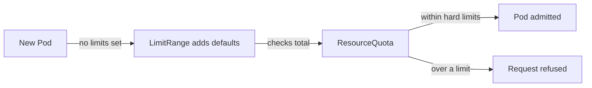

# Namespaces And Resource Isolation

A namespace is a scope for names, permissions and policies. Two objects in different namespaces may have the same name, and a Role in one namespace grants nothing in another. That is all a namespace does by itself. This part covers what stays shared between namespaces and how quotas and default limits keep one namespace from taking shared resources.

## What a namespace separates

A namespace separates:

- object names, so two namespaces can each have a Deployment named `scout`
- the scope of Roles and RoleBindings
- the scope of ResourceQuota and LimitRange objects
- the scope of NetworkPolicy objects and Pod Security labels

A namespace does not separate:

- the nodes. Pods from different namespaces run on the same worker and share its kernel.
- the network. By default every Pod can reach every other Pod and Service, in any namespace, by IP address or DNS name.
- cluster-scoped objects such as nodes, PersistentVolumes, StorageClasses and CustomResourceDefinitions.
- the container runtime, the image cache and the disk of the node.

## See the open network

Renew the playground. The Pod `drifter` in `outpost` is a different namespace from `scout`. Request `scout` from it by its full DNS name:

<!-- astrona:playground:renew -->

```sh
kubectl -n outpost exec deploy/drifter -- curl -s -o /dev/null -w '%{http_code}\n' http://scout.starfleet.svc.cluster.local/healthz
```

The answer is `200`. The namespace did not block the request. Only a policy that restricts network traffic changes that result.

## ResourceQuota

A ResourceQuota limits the total a namespace may use. It can limit the number of objects, such as `pods`, `services` and `secrets`, and the sum of compute resources: `requests.cpu`, `requests.memory`, `limits.cpu`, `limits.memory` and `requests.storage`. The API server checks the quota when it admits a new object and refuses one that would exceed it. Running objects are never removed when a quota is added or lowered.

When a quota covers `requests.cpu` or `limits.memory`, every new Pod must state a request or limit for that resource. A Pod without one is rejected, because the API server cannot add it to the total. A LimitRange supplies defaults so that Pods without values are still accepted.

## LimitRange

A LimitRange sets per-object rules in a namespace. For containers it can set a default request and a default limit that the API server injects into a Pod that has none. It can also set a minimum and a maximum per container and a ratio between limit and request. The injected values are written to the Pod at creation, so the check by the quota sees them.

Without a memory limit a container can use all the memory on the node. The kernel then kills processes on that node when it runs out, including Pods from other namespaces. The memory limit sets a cgroup cap per container, so the kernel kills the offending container first. A CPU request gives a share of CPU time when the node is busy. A CPU limit throttles the container even when the node is idle.



## Try a quota and a LimitRange

Save this as `bay-limits.yaml`:

```yaml
apiVersion: v1
kind: Namespace
metadata:
  name: bay
---
apiVersion: v1
kind: ResourceQuota
metadata:
  name: bay-quota
  namespace: bay
spec:
  hard:
    pods: "3"
    requests.cpu: 500m
    requests.memory: 256Mi
    limits.memory: 512Mi
---
apiVersion: v1
kind: LimitRange
metadata:
  name: bay-limits
  namespace: bay
spec:
  limits:
    - type: Container
      defaultRequest:
        cpu: 50m
        memory: 32Mi
      default:
        memory: 64Mi
```

Apply it and start a Pod without any resource values:

```sh
kubectl apply -f bay-limits.yaml
kubectl -n bay run tiny --image=ghcr.io/stefanprodan/podinfo:6.15.0
kubectl -n bay get pod tiny -o jsonpath='{.spec.containers[0].resources}'
kubectl -n bay describe resourcequota bay-quota
```

The Pod has the default request and limit. The quota output shows `Used` and `Hard` columns. Try a Pod that asks for more than the quota allows:

```sh
kubectl -n bay run big --image=ghcr.io/stefanprodan/podinfo:6.15.0 --overrides='{"spec":{"containers":[{"name":"big","image":"ghcr.io/stefanprodan/podinfo:6.15.0","resources":{"requests":{"cpu":"2"},"limits":{"memory":"64Mi"}}}]}}'
```

The API server answers with `exceeded quota` and names the resource. The Pod is not created.

## Quota limits the total, not the neighbor

Quota and LimitRange protect shared capacity. They do not stop a noisy neighbor from using disk, network bandwidth or the Kubernetes API. API Priority and Fairness protects the API server request queue. A tenant that creates many objects of a kind that no quota covers can still use etcd space. A complete quota lists the object counts the tenant can reach, not only CPU and memory.

## Common pitfalls

> [!WARNING]
> - Believing a namespace blocks network traffic. Without a network policy, Pods reach each other across namespaces.
> - Adding a quota on `requests.cpu` without a LimitRange. Pods with no CPU request are refused.
> - Expecting a new quota to evict running Pods. It checks only new objects.
> - Setting no memory limit on a container that shares a node. One leak can cause kernel out-of-memory kills for neighbors.
> - Counting only CPU and memory in a quota. Object counts protect the API and etcd.
