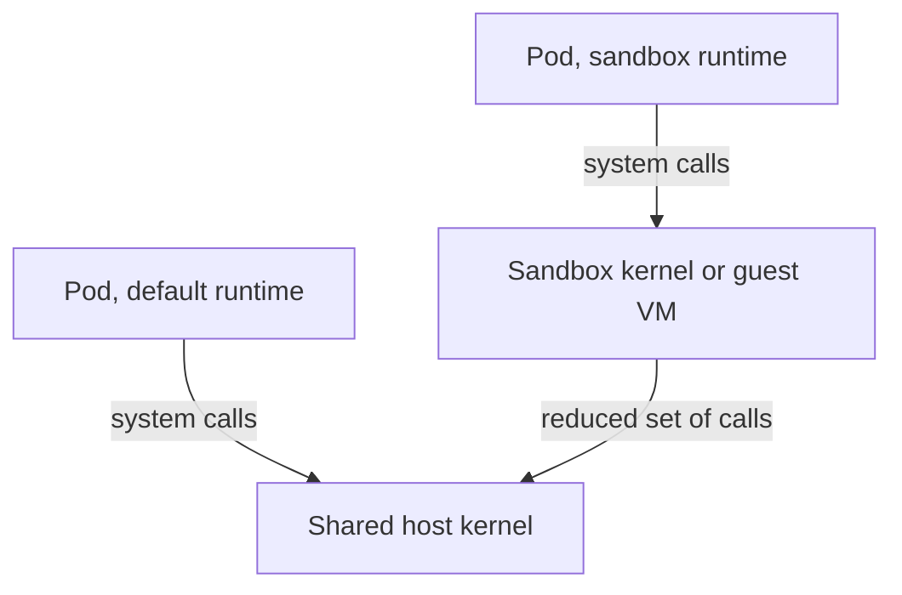

# Node And Runtime Isolation

Containers on one node run as ordinary Linux processes with namespaces and cgroups. They share the node's kernel. This part shows what is shared, which Pod fields remove isolation, and how dedicated nodes and sandbox runtimes add a stronger boundary.

## What containers share

A container is a process started with its own Linux namespaces: process IDs, mounts, network, inter-process communication and hostname. Cgroups limit its CPU and memory use. Seccomp and capabilities limit what system calls it may make. The kernel is the same one that the node and every other container use. A kernel vulnerability, or a container that holds a dangerous capability, can therefore reach every workload on the node.

Some Pod fields remove one of the namespaces:

- `hostPID: true` shows the container every process on the node and lets it send signals to them.
- `hostNetwork: true` puts the container in the node's network namespace, so it sees node interfaces and can reach services that listen only on `localhost` on the node.
- `hostIPC: true` shares inter-process communication objects with the node.
- A `hostPath` volume mounts a node directory. A mount of `/` or of the container runtime socket gives control of the node.
- `privileged: true` removes most limits, including the device filter.

Each of these gives up a boundary that namespace and cgroup isolation would provide. Check which Pods in a cluster use them:

<!-- astrona:playground:renew -->

```sh
kubectl get pods -A -o json | jq -r '.items[] | select(.spec.hostPID == true or .spec.hostNetwork == true or .spec.hostIPC == true or any(.spec.volumes[]?; .hostPath != null)) | .metadata.namespace + "/" + .metadata.name'
```

On a `kind` cluster the system Pods in `kube-system` appear. The workloads in `starfleet` and `outpost` do not.

## Dedicated nodes with taints

A node taint repels Pods that do not tolerate it. A node with a `NoSchedule` taint accepts only Pods with a matching toleration. A label on the node and a `nodeSelector` or node affinity on the Pod send workloads to specific nodes. The two together place a tenant on dedicated nodes: the taint keeps others out, and the selector keeps the tenant in.

A toleration only allows a Pod onto a tainted node. It does not require it. A Pod with the toleration and no selector may still run elsewhere. A taint also does not stop a Pod that runs as a DaemonSet with a broad toleration. Check both directions when a design depends on dedicated nodes. Label and taint the playground node:

```sh
NODE="$(kubectl get nodes -o jsonpath='{.items[0].metadata.name}')"
kubectl label node "$NODE" tenant=blue --overwrite
kubectl taint node "$NODE" tenant=blue:NoSchedule --overwrite
```

Then start a Pod without a toleration and read its state:

```sh
kubectl -n outpost run untolerated --image=ghcr.io/stefanprodan/podinfo:6.15.0
kubectl -n outpost get pod untolerated
kubectl -n outpost describe pod untolerated | grep -A3 Events
```

The Pod stays `Pending` and the event says that no node matches because of an untolerated taint. Remove the taint afterwards:

```sh
kubectl taint node "$NODE" tenant=blue:NoSchedule-
kubectl -n outpost delete pod untolerated
```

Dedicated nodes still share the control plane, the network and the cluster administrators. They remove co-location with other tenants and do not remove the shared parts above.

## Sandbox runtimes with RuntimeClass

A RuntimeClass names a container runtime configuration on the node. The default runtime, usually runc, starts containers directly on the host kernel. A sandbox runtime such as gVisor places a user-space kernel between the container and the host, and Kata Containers starts each Pod in a lightweight virtual machine with its own guest kernel. A system call from the container then reaches the sandbox first, so a flaw in the host kernel is harder to reach.

The RuntimeClass object holds the name of a handler that the node's container runtime must have configured. A Pod selects it with `runtimeClassName`. Save this as `runtimeclass.yaml`:

```yaml
apiVersion: node.k8s.io/v1
kind: RuntimeClass
metadata:
  name: sandboxed
handler: runsc
```

Apply it and run a Pod that uses it:

```sh
kubectl apply -f runtimeclass.yaml
kubectl -n outpost run boxed --image=ghcr.io/stefanprodan/podinfo:6.15.0 --overrides='{"spec":{"runtimeClassName":"sandboxed"}}'
kubectl -n outpost get pod boxed
```

The `kind` node has no `runsc` handler, so the Pod does not start and its events name the missing runtime. That is the correct result: a RuntimeClass is only a name, and the node's runtime must provide the handler. Delete the Pod with `kubectl -n outpost delete pod boxed`.

A sandbox adds startup cost and compatibility limits, for example in the system calls that gVisor supports. It reduces the shared-kernel risk for the Pods that use it and leaves the network, the nodes' management plane and the cluster API unchanged.



## Crossing namespaces through identity

Namespaces can be joined by permissions. A RoleBinding in namespace A may name a ServiceAccount from namespace B as its subject. That ServiceAccount then acts in A with the Role's permissions. This is intentional for shared services and an easy way to make a hidden path between tenants. List the cross-namespace subjects with this command:

```sh
kubectl get rolebindings -A -o json | jq -r '.items[] | .metadata.namespace as $ns | .subjects[]? | select(.kind == "ServiceAccount" and .namespace != $ns) | $ns + " <- " + .namespace + "/" + .name'
```

## Common pitfalls

> [!WARNING]
> - Calling a design isolated without naming the shared kernel, network, nodes and administrators.
> - Using a toleration without a node selector and expecting Pods to run only on the dedicated nodes.
> - Creating a RuntimeClass and forgetting to configure the handler on the nodes. Pods then fail to start.
> - Allowing `hostPath`, `hostPID` or `hostNetwork` for convenience. Each one removes a boundary.
> - Binding a ServiceAccount from another namespace without a record of why.
