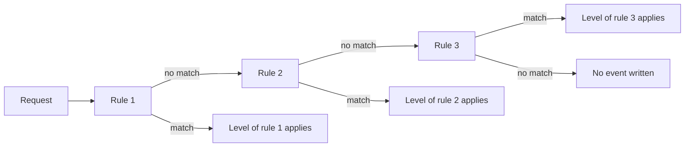

# Audit Events, Stages And Policy Levels

Every request to the Kubernetes API passes through the API server. With audit logging on, the API server writes one JSON event for each stage of a request that the policy selects. This part shows what an event contains, when each stage fires, how the policy sets the level of detail and how to turn the feature on for the playground.

## What an event holds

An audit event is one line of JSON in the log file. The fields that answer most questions are:

- `auditID`: a unique value shared by every event of the same request.
- `stage`: the point in the request at which the event was written.
- `verb`: the action, such as `get`, `list`, `watch`, `create`, `update`, `patch` or `delete`.
- `user.username` and `user.groups`: the identity that the authentication step produced.
- `sourceIPs` and `userAgent`: where the request came from and which client sent it.
- `objectRef`: the `resource`, `namespace`, `name` and `subresource` that the request targeted.
- `responseStatus.code`: the HTTP status the API server returned.
- `requestURI`: the path and query string that the client called.
- `level`: how much detail the policy chose for this event.
- `annotations`: extra facts from the API server, such as the authorization decision.

The caller is the identity the cluster authenticated, not a person. A shared kubeconfig or a stolen ServiceAccount token produces events with the same `user.username` as the rightful owner.

## The four stages

A request moves through stages, and each one can produce an event:

- `RequestReceived`: written as soon as the audit handler gets the request, before any other handler runs.
- `ResponseStarted`: written after the response headers are sent and before the body. Only long-running requests such as `watch` produce it.
- `ResponseComplete`: written after the response body is complete.
- `Panic`: written when the API server panics while handling the request.

A normal `delete` therefore writes two events with the same `auditID`: `RequestReceived` and `ResponseComplete`. The first one has no `responseStatus`, because no answer exists yet. Count actions from `ResponseComplete` events, and read `responseStatus.code` to see whether the action succeeded.

## The four levels

The level of a rule sets how much of the request is stored:

- `None`: no event is written.
- `Metadata`: the event holds the caller, time, verb and target. It holds no request body and no response body.
- `Request`: the event holds the metadata and the request body. It holds no response body. It does not apply to requests for non-resource URLs.
- `RequestResponse`: the event holds the metadata, the request body and the response body. It does not apply to requests for non-resource URLs.

More detail costs more storage and more API server memory. It can also write data into the log that the log should not hold, which the next part covers.

## How a policy matches

A policy is a file of kind `Policy` with a list of `rules`. The API server compares each request to the rules in order, and the first rule that matches sets the level. Later rules are not read for that request. If no rule matches, the event is not written. A policy with no `rules` field is invalid and the API server refuses to start with it.

A rule can match on:

- `users` and `userGroups`: the authenticated identity.
- `verbs`: a list of actions.
- `resources`: a list of entries with a `group`, the `resources` names and optional `resourceNames`. An empty `group` means the core API group.
- `namespaces`: a list of namespaces. The empty string selects objects that have no namespace.
- `nonResourceURLs`: paths such as `/healthz*` or `/version`, with `*` allowed at the end.

The field `omitStages` can sit at the top of the policy or inside a rule and lists stages that produce no event. A rule with only a `level` matches everything that reaches it.



## A first policy

Save this as `audit-policy.yaml`:

```yaml
apiVersion: audit.k8s.io/v1
kind: Policy
omitStages:
  - RequestReceived
rules:
  - level: None
    nonResourceURLs: ["/healthz*", "/livez*", "/readyz*", "/version"]
  - level: Metadata
    resources:
      - group: ""
        resources: ["secrets"]
  - level: RequestResponse
    resources:
      - group: "apps"
        resources: ["deployments"]
  - level: None
    verbs: ["get", "list", "watch"]
  - level: Metadata
```

The first rule drops health checks. The second records Secret access without bodies. The third records Deployment changes with both bodies. The fourth drops all other reads, and the last rule records everything that remains at `Metadata`. Each rule is placed so that a more specific rule comes before the broader rule that would also match.

## Turn audit logging on in the playground

The API server on a `kind` cluster is a static Pod. The kubelet reads its manifest from `/etc/kubernetes/manifests/kube-apiserver.yaml` on the control plane node and restarts the Pod when the file changes. Audit logging needs two flags, `--audit-policy-file` and `--audit-log-path`, and two `hostPath` volumes so that the Pod can read the policy and write the log.

<!-- astrona:playground:renew -->

Set the container name and copy the policy to the node:

```sh
CP=astro-ats-043-playground-070-01-control-plane
podman exec "$CP" mkdir -p /etc/kubernetes/audit /var/log/kubernetes/audit
podman cp audit-policy.yaml "$CP":/etc/kubernetes/audit/audit-policy.yaml
podman exec "$CP" cp /etc/kubernetes/manifests/kube-apiserver.yaml /etc/kubernetes/kube-apiserver.before-audit.yaml
```

The backup goes outside the `manifests` directory. A copy inside it would start as a second API server Pod.

Add the flags and volumes with `sed`, working on a copy and moving it back in one step:

```sh
podman exec "$CP" cp /etc/kubernetes/manifests/kube-apiserver.yaml /tmp/kube-apiserver.yaml
podman exec "$CP" sed -i \
  -e '/^    - kube-apiserver$/a\    - --audit-policy-file=/etc/kubernetes/audit/audit-policy.yaml\n    - --audit-log-path=/var/log/kubernetes/audit/audit.log' \
  -e '/^    volumeMounts:$/a\    - mountPath: /etc/kubernetes/audit\n      name: audit-policy\n      readOnly: true\n    - mountPath: /var/log/kubernetes/audit\n      name: audit-log' \
  -e '/^  volumes:$/a\  - hostPath:\n      path: /etc/kubernetes/audit\n      type: Directory\n    name: audit-policy\n  - hostPath:\n      path: /var/log/kubernetes/audit\n      type: DirectoryOrCreate\n    name: audit-log' \
  /tmp/kube-apiserver.yaml
podman exec "$CP" mv /tmp/kube-apiserver.yaml /etc/kubernetes/manifests/kube-apiserver.yaml
```

The API server restarts and `kubectl` fails for up to a minute. Wait until it answers again:

```sh
until kubectl --request-timeout=5s get --raw=/readyz >/dev/null 2>&1; do sleep 5; done
kubectl -n kube-system get pod -l component=kube-apiserver -o jsonpath='{.items[0].spec.containers[0].command}' | tr ',' '\n' | grep audit
```

The output lists both `--audit` flags. If `kubectl` does not answer after two minutes, the manifest is wrong. Restore the backup with `podman exec "$CP" cp /etc/kubernetes/kube-apiserver.before-audit.yaml /etc/kubernetes/manifests/kube-apiserver.yaml` and compare it with the edit.

## Read your own request in the log

Create and delete a Deployment, then find the events:

```sh
kubectl -n outpost create deployment lookout --image=ghcr.io/stefanprodan/podinfo:6.15.0
kubectl -n outpost delete deployment lookout
podman exec "$CP" cat /var/log/kubernetes/audit/audit.log \
  | jq -c 'select(.objectRef.name == "lookout") | {stage, verb, level, user: .user.username, code: .responseStatus.code, body: has("requestObject")}'
```

Two events appear, `create` and `delete`, both at `RequestResponse` with `ResponseComplete`. The `create` event has `body: true`. The `user` is `kubernetes-admin`. No `RequestReceived` events appear, because the policy omits that stage.

## Common pitfalls

> [!WARNING]
> - Writing a broad rule before a specific one. The first match wins, so the specific rule never applies.
> - Counting `RequestReceived` and `ResponseComplete` as two actions. They are two events of one request.
> - Treating `user.username` as a person. It is the identity of the credential.
> - Putting the manifest backup inside `/etc/kubernetes/manifests`. The kubelet starts it as another Pod.
> - Pointing `--audit-policy-file` at a file the Pod cannot read. The API server does not start.
