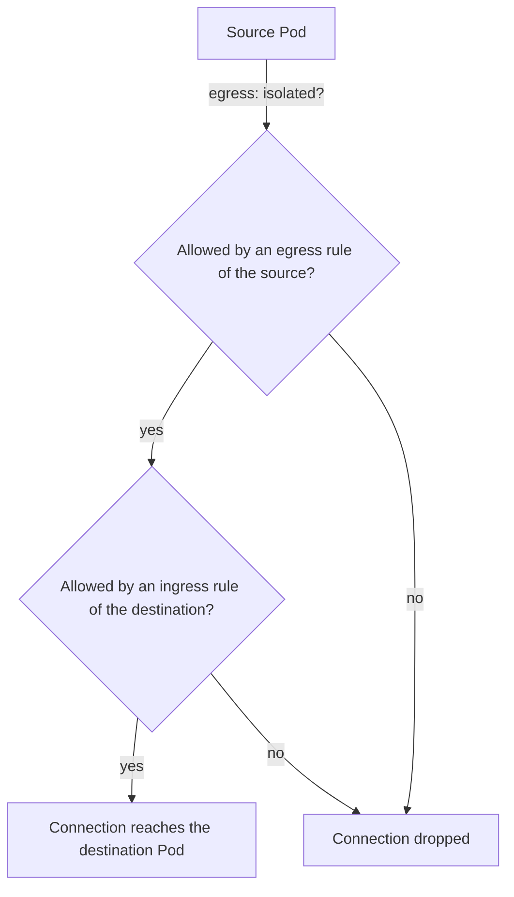

# How NetworkPolicy Selects And Allows Traffic

A NetworkPolicy is a namespaced object that selects Pods and lists the connections allowed to or from them. This part shows what happens before any policy exists, what a policy changes for the Pods it selects, and how to write rules that name the allowed callers and ports.

## The open default

Without a NetworkPolicy, a Pod accepts connections from any Pod in the cluster and starts connections to any address. The namespace does not matter. A Pod in `outpost` reaches a Service in `starfleet` by its DNS name `scout.starfleet.svc`.

<!-- astrona:playground:renew -->

Check it from `drifter` in `outpost`:

```sh
kubectl -n outpost exec deploy/drifter -- curl -s -o /dev/null -w '%{http_code}\n' --max-time 5 http://scout.starfleet.svc
```

The command prints `200`. No identity check happens at this level. The network accepts the connection because nothing forbids it.

## Isolation

A Pod is isolated for a direction when at least one NetworkPolicy selects it and lists that direction in `policyTypes`. An isolated Pod accepts only the connections that some policy allows in that direction. A Pod that no policy selects for a direction stays open in that direction.

- `Ingress` covers connections that arrive at the Pod.
- `Egress` covers connections that the Pod starts.

A policy never denies a connection by itself. It selects Pods and, by selecting them, isolates them. The rules in the policy are only additions to the list of allowed connections. When two policies select the same Pod, the Pod allows what either one allows.



When the source is not isolated for egress, the first test passes. When the destination is not isolated for ingress, the second test passes. Both ends are tested separately, and an allowance at one end does not replace a missing allowance at the other.

## Default deny

A policy with an empty `podSelector` selects every Pod in its namespace. If it lists `Ingress` and has no `ingress` rules, it allows nothing, so every Pod in the namespace stops accepting connections. Save this as `default-deny-ingress.yaml`:

```yaml
apiVersion: networking.k8s.io/v1
kind: NetworkPolicy
metadata:
  name: default-deny-ingress
  namespace: starfleet
spec:
  podSelector: {}
  policyTypes:
    - Ingress
```

Apply it and repeat the call from `drifter`:

```sh
kubectl apply -f default-deny-ingress.yaml
kubectl -n outpost exec deploy/drifter -- curl -s -o /dev/null -w '%{http_code}\n' --max-time 5 http://scout.starfleet.svc
echo "exit code: $?"
```

The call does not return a status. The network drops the packets without an answer, so `curl` waits for the 5 seconds, prints `000` and exits with code 28. A refusal would return at once. A silent wait is the sign of a dropped packet.

## Allow rules

An `ingress` rule has two lists. `from` names the peers that may connect, and `ports` names the ports they may use. A connection matches a rule when it matches one entry of `from` and one entry of `ports`. An omitted or empty `from` allows every source. An omitted or empty `ports` allows every port.

A peer in `from` is one of:

- `podSelector`: Pods with matching labels in the policy's own namespace.
- `namespaceSelector`: every Pod in the namespaces with matching labels.
- `podSelector` and `namespaceSelector` together in one entry: Pods with matching labels in namespaces with matching labels.
- `ipBlock`: an address range.

Ports in a policy are the ports of the Pod, not of the Service. `scout` listens on 9898, and its Service listens on 80. A rule for port 80 matches nothing, because the packet that reaches the Pod is addressed to 9898.

Save this as `allow-shuttle-to-scout.yaml`:

```yaml
apiVersion: networking.k8s.io/v1
kind: NetworkPolicy
metadata:
  name: allow-shuttle-to-scout
  namespace: starfleet
spec:
  podSelector:
    matchLabels:
      app: scout
  policyTypes:
    - Ingress
  ingress:
    - from:
        - podSelector:
            matchLabels:
              app: shuttle
      ports:
        - protocol: TCP
          port: 9898
```

Apply it and try the three callers:

```sh
kubectl apply -f allow-shuttle-to-scout.yaml
kubectl -n starfleet exec deploy/shuttle -- curl -s -o /dev/null -w '%{http_code}\n' --max-time 5 http://scout.starfleet.svc
kubectl -n starfleet exec deploy/probe -- curl -s -o /dev/null -w '%{http_code}\n' --max-time 5 http://scout.starfleet.svc
kubectl -n outpost exec deploy/drifter -- curl -s -o /dev/null -w '%{http_code}\n' --max-time 5 http://scout.starfleet.svc
```

Only the call from `shuttle` returns `200`. The other two time out. The new policy allows `shuttle` to reach `scout`. The deny policy still isolates the other Pods, so `probe` stays closed to everyone, including `shuttle`.

## Check what selects a Pod

When a connection fails, list the policies and the Pods they select:

```sh
kubectl -n starfleet get networkpolicy
kubectl -n starfleet describe networkpolicy allow-shuttle-to-scout
kubectl -n starfleet get pods --show-labels
```

The `describe` output prints the selected Pods by label, the allowed peers and the ports. Compare the labels to the Pods that fail. A policy that selects no Pods has no effect.

## Enforcement

The API server stores a NetworkPolicy whether or not the cluster can enforce it. Enforcement belongs to the network plugin. A plugin that does not implement the API leaves every Pod open and gives no error. The playground uses kindnet, which enforces ingress and egress policies. On another cluster, test one blocked connection before trusting a policy.

## Common pitfalls

> [!WARNING]
> - Writing a Service port in a rule. Rules match the Pod port after the Service has forwarded the packet.
> - Expecting a policy to deny traffic by itself. It allows traffic for the Pods it selects, and only those Pods become isolated.
> - Forgetting that `podSelector` in `from` stays in the policy's own namespace.
> - Using an empty `from` or `ports` list to mean nothing. An empty or omitted list means all.
> - Trusting a policy on a network plugin that does not enforce it.
